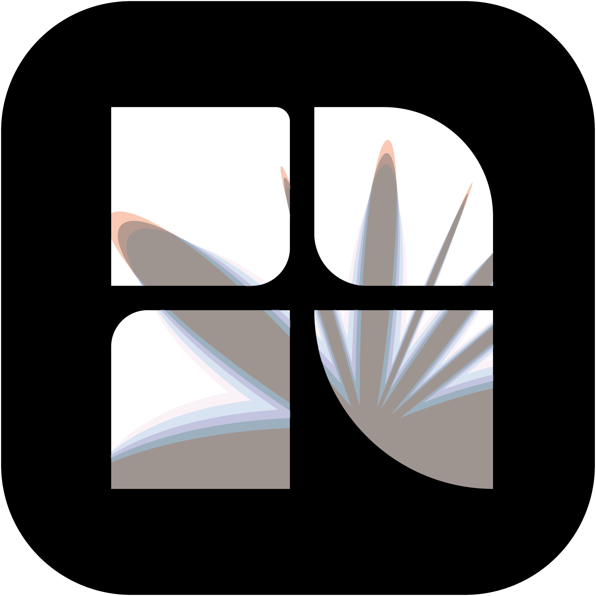
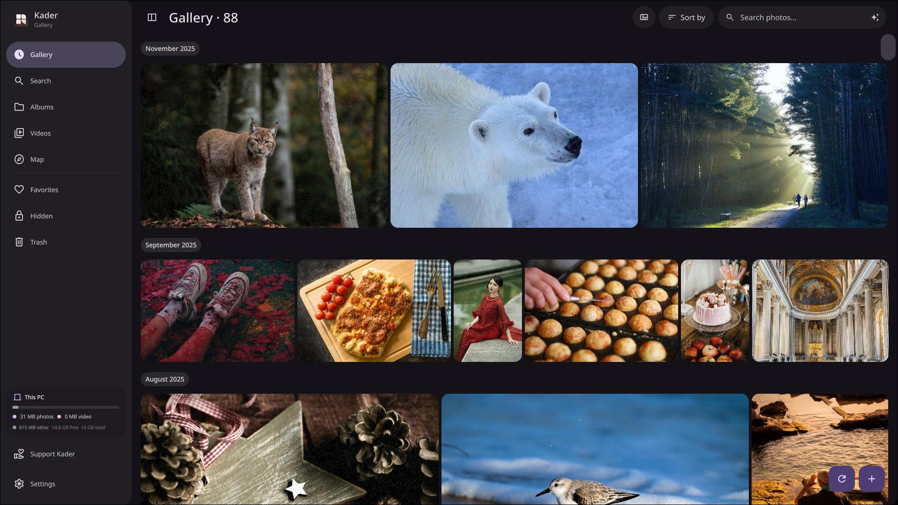
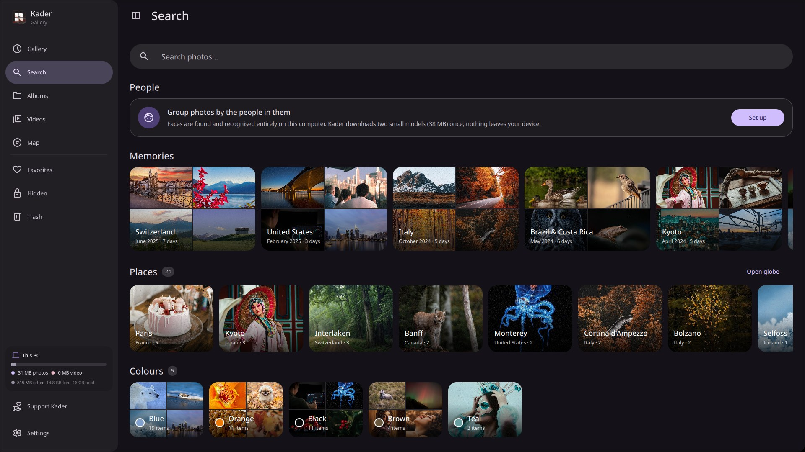
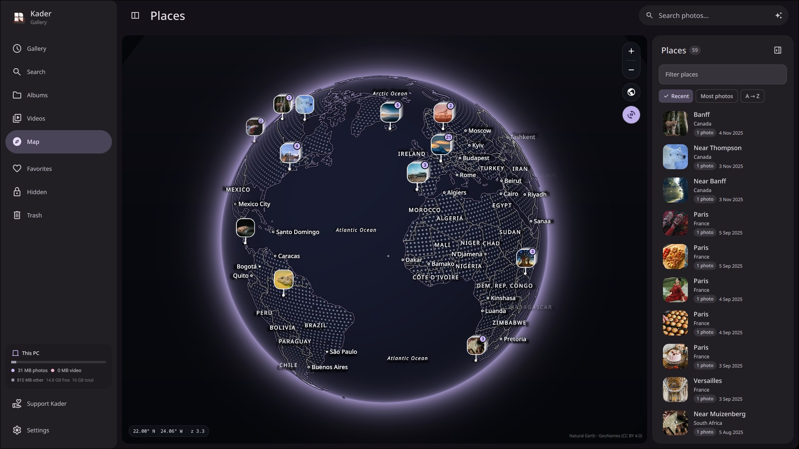

<p align="center">
  
</p>

<h1 align="center">Kader</h1>

<p align="center">A fast photo gallery for Linux and Windows.</p>

<p align="center">
  <a href="https://github.com/vndreiii/Kader/releases/latest"></a>
  <a href="https://github.com/vndreiii/Kader/actions/workflows/ci.yml"></a>
  
  <a href="https://vndreiii.com/programs/kader/"></a>
</p>

<p align="center">
  <a href="https://vndreiii.com/programs/kader/"><b>Website</b></a> ·
  <a href="https://github.com/vndreiii/Kader/releases/latest"><b>Download</b></a> ·
  <a href="CHANGELOG.md"><b>Changelog</b></a>
</p>

<p align="center">
  
</p>

---

## Features

- **Gallery.** Browse your photos and videos in a mosaic, a grid or a list. The date headers show the month.
- **Albums.** Kader makes one album for each folder. You can pin an album and set its cover.
- **Search.** Search for people, places, colours, dates and file names. You can also describe a photo with words.
- **People.** Kader finds faces and groups them. Name a person to see all of their photos.
- **Places.** See your geotagged photos on a 3D globe or on a map.
- **Memories.** Each week, Kader makes up to five short videos from the photos of one day. Each video has music. You can play, save or delete it.
- **Viewer.** Zoom in to see single pixels. Move between photos with the keyboard or a touchpad.
- **Video.** Play, trim and loop videos.
- **RAW photos.** Kader shows RAW files from most cameras.
- **Private by design.** Hide photos behind a password. Thumbnails stay encrypted on your disk.
- **Storage.** See what uses your disk space. Find duplicate files and delete them.
- **Colours.** The app can use your wallpaper or your desktop accent colour.

<p align="center">
  
  
</p>

## Download

Get the latest version from the [Releases page](https://github.com/vndreiii/Kader/releases/latest).
Kader updates itself. Each update is signed. Kader checks the signature before it installs the update.

| Platform | File | How to install |
|---|---|---|
| Linux (all distributions) | `Kader-<version>-x86_64.AppImage` | Run `chmod +x` on the file. Then run it. |
| Arch Linux | `kader-<version>-1-x86_64.pkg.tar.zst` | Run `sudo pacman -U` with the file. |
| Windows 10 and 11 | `Kader-<version>-windows-x64-setup.exe` | Run the installer. You do not need administrator rights. |
| Windows 10 and 11 (portable) | `Kader-<version>-windows-x64-portable.zip` | Unzip the file anywhere. Run `kader.exe`. Kader keeps its data in a `data` folder next to the program. |

## Start Kader

```bash
kader                        # open the gallery
kader /path/to/photo.jpg     # open one file
```

## Build from source

You need these tools: CMake, a C++17 compiler, Rust (`cargo`), Qt 6.5 or later, libvips, Exiv2, LibRaw, Poppler and OpenSSL.
You also need FFmpeg to make Memories and to trim videos.

```bash
cmake -B build -DCMAKE_BUILD_TYPE=Release
cmake --build build -j$(nproc)
./build/kader
```

On Arch Linux, build the package:

```bash
cd packaging/arch && makepkg -si
```

On Windows, use an [MSYS2](https://www.msys2.org) UCRT64 shell:

```bash
pacman -S --needed mingw-w64-ucrt-x86_64-{toolchain,cmake,ninja,pkgconf,rust,qt6-base,qt6-declarative,qt6-shadertools,qt6-multimedia,qt6-positioning,qt6-svg,qt6-imageformats,qt6-tools,libvips,exiv2,libraw,poppler,libheif,openssl,ffmpeg,nsis}
cmake -B build -G Ninja -DCMAKE_BUILD_TYPE=Release
cmake --build build
packaging/windows/deploy.sh build dist   # makes the portable .zip and the setup .exe
```

## Colours and matugen

Go to **Settings → Appearance → Colours**. Choose where the colours come from:

- **Kader:** the built-in purple.
- **Preset:** one of twelve colours.
- **System:** your wallpaper through [matugen](https://github.com/InioX/matugen), or your desktop accent colour (Windows and KDE).

**Colour style** sets the Material 3 scheme. To get the same colours as matugen, use the same style as the matugen `--type` option.

To use matugen, do these steps:

1. Copy [`packaging/matugen/kader.json`](packaging/matugen/kader.json) to `~/.config/matugen/templates/kader.json`.
2. Add this to `~/.config/matugen/config.toml`:

```toml
[templates.kader]
input_path = "~/.config/matugen/templates/kader.json"
output_path = "~/.config/kader/matugen.json"
```

Each time matugen runs, Kader changes its colours immediately.

## Links

- Website: <https://vndreiii.com/programs/kader/>
- Releases: <https://github.com/vndreiii/Kader/releases>
- Changelog: [CHANGELOG.md](CHANGELOG.md)
- Music for Memories: see [assets/music/LICENSES.md](assets/music/LICENSES.md)
